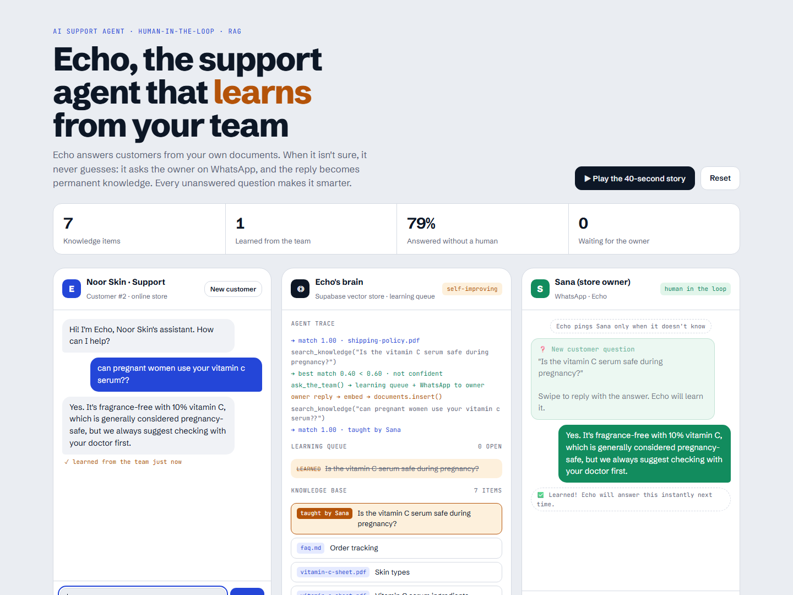
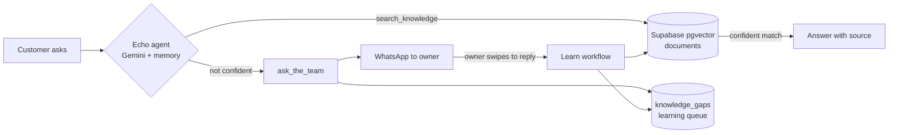

# Echo: the support agent that learns from your team

Most support bots have two problems: they **make up answers**, and they **never get smarter**.
Echo fixes both.

- It answers customers **only from the business's own documents** (RAG over Supabase pgvector).
- When it isn't confident, it **doesn't guess**. It puts the question in a learning queue and **asks the owner on WhatsApp**.
- The owner simply **swipes to reply**. Echo stores that answer as new knowledge, so **the next customer gets it instantly**.

Every question it couldn't answer makes it better. After a few weeks, the owner almost never gets pinged.

**▶ Interactive demo:** https://laveeza-fatima.github.io/echo-support-agent/
Chat as a customer, answer as the owner, and watch Echo learn in real time (or press *Play the 40-second story*).



---

## 1. The learning loop



## 2. What makes it different

| Typical chatbot | Echo |
|---|---|
| Guesses when it doesn't know | Admits it, logs the question, asks a human |
| Same knowledge forever | Learns from every answered question |
| Owner edits documents to improve it | Owner just replies on WhatsApp, like to a colleague |
| No idea what customers ask that isn't documented | `knowledge_gaps` table = a live list of missing documentation |

## 3. What's in the repo

```
├── index.html                          # Interactive demo (runs fully in the browser)
├── supabase/setup.sql                  # pgvector table, match_documents(), learning queue
├── workflows/
│   ├── 01-ingest-documents.json        # Upload PDFs/docs via a form → chunk → embed → Supabase
│   ├── 02-chat-agent.json              # Customer chat: Gemini agent + search_knowledge + ask_the_team
│   ├── 03-escalate-to-owner.json       # Sub-workflow: queue the question + WhatsApp the owner
│   └── 04-learn-from-owner.json        # Owner's WhatsApp reply → close question → embed as knowledge
└── docs/demo.png
```

## 4. Setup

**You need:** n8n (Cloud or self-hosted), a free Supabase project, a Google Gemini API key
([Google AI Studio](https://aistudio.google.com)), and a WhatsApp Business Cloud API number
([Meta for Developers](https://developers.facebook.com/docs/whatsapp/cloud-api/get-started). The free test number works for trying it out).

1. **Supabase:** SQL Editor → paste `supabase/setup.sql` → Run.
2. **n8n:** import the four files in `workflows/` (*Workflows → Import from file*).
3. **Credentials:** connect *Supabase*, *Google Gemini* and *WhatsApp* in each workflow's nodes.
4. **Placeholders:**
   - In **03**: set `YOUR_WHATSAPP_PHONE_NUMBER_ID` and the owner's number (`OWNER_WHATSAPP_NUMBER_WITH_COUNTRY_CODE`, e.g. `923001234567`).
   - In **04**: set `YOUR_WHATSAPP_PHONE_NUMBER_ID`.
   - In **02**: open the `ask_the_team` tool and pick workflow **03** (replaces `PASTE_ID_OF_WORKFLOW_03`).
5. **Teach it:** open workflow **01**'s form URL and upload your FAQs/policies/product sheets.
6. **Activate** workflows 02, 03 and 04, then chat via workflow 02's chat URL.

> **WhatsApp note:** Meta only allows free-form messages to someone who messaged your number in the last 24 hours.
> For always-on use, create a *Utility* message template (e.g. `echo_new_question`: "New customer question: {{1}}.
> Reply to this message with the answer.") and switch node **03 → Ask owner on WhatsApp** to *Send Template*.

## 5. Roadmap

- [ ] Send the owner's answer back to the waiting customer automatically (WhatsApp customers)
- [ ] Weekly "knowledge gaps" digest to the owner
- [ ] Confidence threshold tuning per business
- [ ] Multi-language knowledge (English + Urdu)

---

Built by **Laveeza Fatima**, AI Agents & Automation Engineer · [Portfolio](https://laveeza-fatima.github.io) · [LinkedIn](https://www.linkedin.com/in/laveeza-fatima-320a2031b/)

Licensed under the [MIT License](LICENSE).
